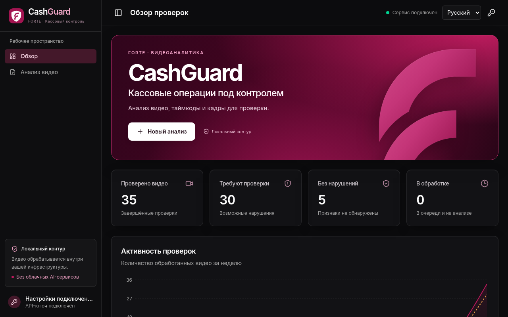
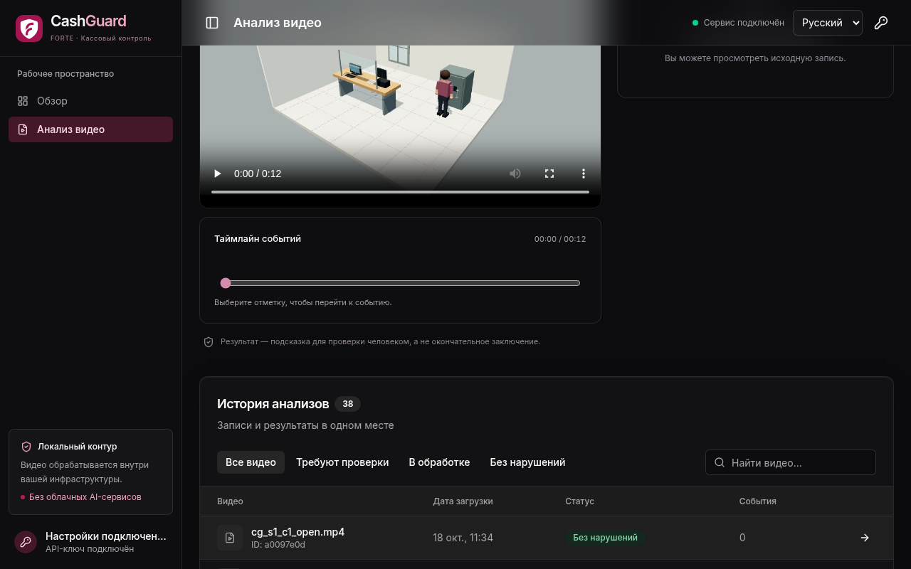

<div align="center">

# CashGuard

**Контроль кассовой дисциплины по видео: нарушение — с кадром, таймкодом и нормой РК**

Datathon 26 · кейс ForteBank · команда **YeahGrinders**

[**Открыть сервис**](https://fortecashguard.up.railway.app) ·
[**О решении**](https://fortecashguard.up.railway.app/about.html) ·
[**Презентация**](presentations/CashGuard/CashGuard_YeahGrinders.pdf) ·
[**Типы нарушений**](docs/violation_types.md)


<sub>В демонстрации — синтетический ролик, созданный командой с нуля; кадры датасета хакатона не публикуются.</sub>

</div>

## Что делает

- Загружаете запись кассы — через 1–4 минуты получаете вердикт: **«Нарушение не обнаружено»** или **«Обнаружены признаки возможных нарушений»**.
- Для каждого события: тип, таймкод, 1–3 кадра-доказательства и описание только того, что измерено на видео.
- Каждый тип связан с пунктом норматива РК и **дословной цитатой**, сверенной с adilet.zan.kz (НБРК № 231, НБРК № 14, АРРФР № 53).
- Всё работает **локально**: без облачных AI-сервисов, без распознавания лиц, на обычном CPU.

## Результаты

| Показатель | Значение | Как измерено |
|---|---|---|
| Верные вердикты на **незнакомой камере** | **77,5 %** | каждая из 7 постановок камеры по очереди исключалась из обучения |
| Ложные тревоги на нормальных видео | **0 из 19** | и в проверке на незнакомой камере тоже 0 |
| Все 40 видео датасета, рабочий стенд | 35 / 40 | оценка на данных разработки |
| Тип нарушения верен | 15 из 16 найденных | |
| Медиана ошибки таймкода | 0,6 с | |
| Устойчивость к искажениям | 1 ложная тревога на 120 копий | отражение, приближение, затемнение всех 40 видео |
| Нагрузка как у жюри | 5 видео одновременно — все за 3 мин 49 с | через публичный API, лимит 5 минут |

## Как устроено

```
видео .mov ─► восприятие (YOLOX, RTMPose, CLIP, OWLv2) ─► сцена: кассир, рабочее место, стол, дверь, сейф
           ─► кандидаты событий ─► обученный порог на каждый тип ─► описание + норма РК + кадры ─► JSON / интерфейс
```

- **Не запоминаем комнату:** расстояния — в долях роста кассира, зоны находятся по движению людей, без разметки камеры.
- **Решает не «чёрный ящик»:** по одному измеренному признаку и обученному порогу на тип; функция потерь «пропуск вдвое дороже ложной тревоги».
- **Модели с коммерческими лицензиями:** YOLOX (Apache-2.0), RTMPose (Apache-2.0), CLIP (MIT), OWLv2 (Apache-2.0).
- **Сервис:** React-интерфейс, Go API, Python-анализатор, PostgreSQL — один Docker-контейнер; лимит 5 минут считается от загрузки, при очереди время делится между видео.

| Интерфейс | Результат анализа |
|---|---|
|  |  |

## API (ТЗ §10)

```bash
curl -X POST https://fortecashguard.up.railway.app/api/v1/analyze -H "X-API-Key: <ключ>" -F "file=@video.mov"
# {"job_id":"…","status":"processing"}
curl https://fortecashguard.up.railway.app/api/v1/jobs/<job_id> -H "X-API-Key: <ключ>"
# {"status":"done","verdict":"violation","violations":[{"type":"…","timecode_sec":10,"description":"…","evidence_frames":[…],"rule":{…}}]}
```

## Запуск у себя

```bash
docker build -t cashguard .                     # веса скачиваются при сборке, анализ потом без интернета
docker run -p 8080:8080 -e API_KEY=<ключ-от-16-символов> -e DATABASE_URL=postgres://… cashguard
```

Полная инструкция: [`docs/deploy_railway.md`](docs/deploy_railway.md), материалы сдачи: [`SUBMISSION.md`](SUBMISSION.md),
модель и эксперименты: [`docs/ml_model.md`](docs/ml_model.md).

## Ограничения — честно

- Пока не распознаются действия рук с деньгами: возврат денег клиенту, приём без документа, вскрытие сумки без пересчёта.
- Типы с 1–2 обучающими примерами могут пропускаться на новом ракурсе; модель настроена не выдавать ложных тревог.
- Результат — подсказка для проверки человеком, а не юридическое заключение.

## Структура репозитория

| Путь | Что внутри |
|---|---|
| `app/ml/` | анализатор: восприятие, трекинг, сцена, кандидаты событий, обученные пороги, описания |
| `app/rules/norms.yaml` | 21 тип нарушения: документ, пункт, дословная цитата, условия и исключения |
| `models/` | обученные пороги (`scorer.json`) и модель ролей в сцене (`track_model.json`) |
| `src/backend/` | Go API: контракт жюри, очередь с делением времени, PostgreSQL |
| `src/frontend/` | React-интерфейс: загрузка, статус, результат, история |
| `scripts/` | обучение, оценка, проверки «как жюри» (`smoke_jury.sh`, `smoke_queue.sh`) |
| `tests/`, `src/backend/**/*_test.go` | 176 тестов Python и 14 тестов Go |
| `docs/` | модель и эксперименты, нормативные источники, деплой, исследования |

## Разработка

```bash
uv venv --python 3.11 .venv
uv pip install --python .venv/bin/python -r requirements-ml.txt --extra-index-url https://download.pytorch.org/whl/cpu
bash scripts/download_models.sh                         # веса моделей, один раз
.venv/bin/python scripts/analyze_video.py video.mov      # JSON по контракту жюри
.venv/bin/python -m pytest tests -q                      # тесты анализатора
(cd src/backend && go test ./...)                        # тесты API
BASE=https://fortecashguard.up.railway.app KEY=<ключ> bash scripts/smoke_jury.sh video.mov   # проверка как у жюри
```

## Документация

- [`docs/ml_model.md`](docs/ml_model.md) — модель, метрики, принятые и отклонённые эксперименты
- [`docs/normative_sources.md`](docs/normative_sources.md) — нормативные источники и как сверялись цитаты
- [`docs/violation_types.md`](docs/violation_types.md) — типы нарушений, статус распознавания, нормы
- [`docs/deploy_railway.md`](docs/deploy_railway.md) — рабочий стенд, замеры времени и нагрузки
- [`SUBMISSION.md`](SUBMISSION.md) — материалы сдачи по разделу 8 ТЗ
- [`docs/dev_notes.md`](docs/dev_notes.md) — исторические заметки разработки интерфейса и бэкенда
